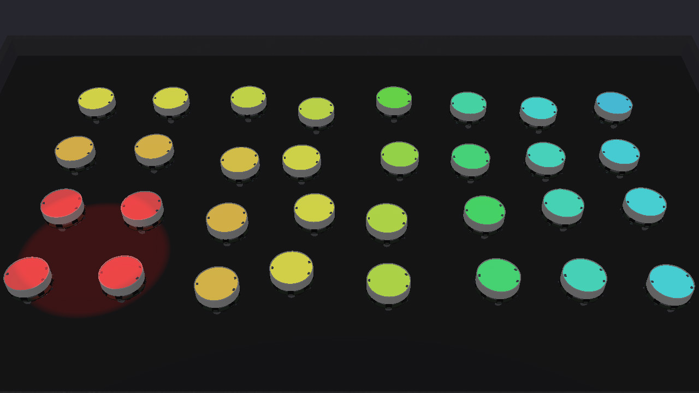
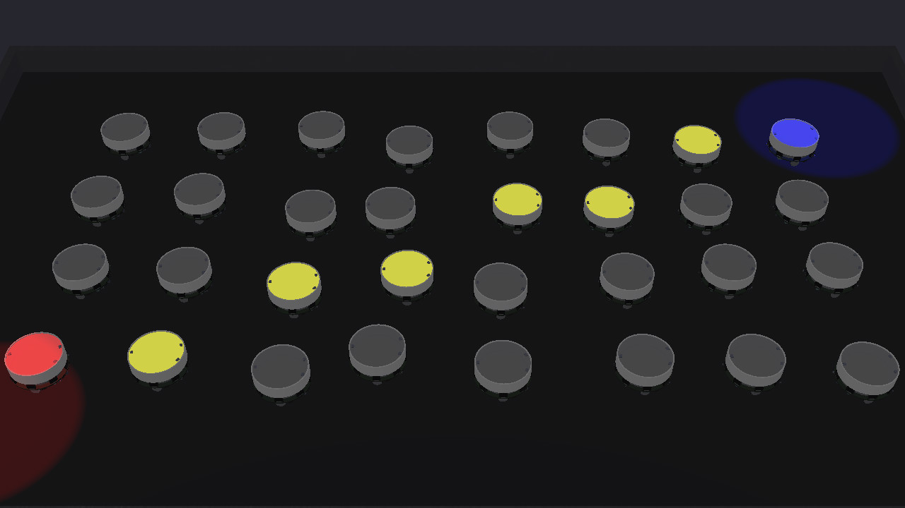
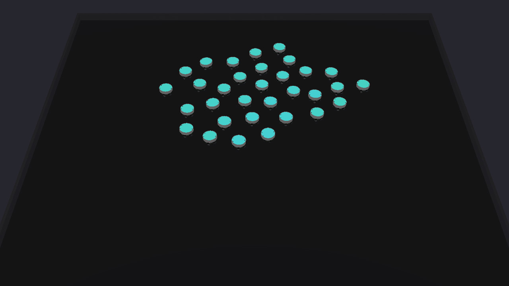
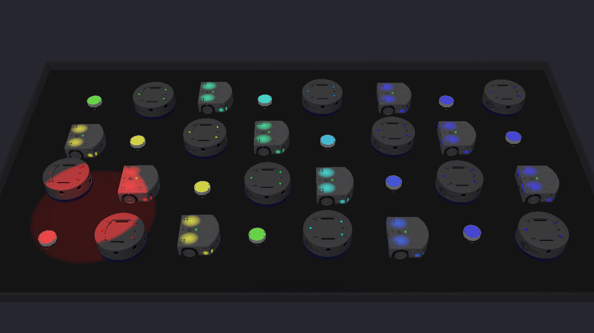

# phyelds Webots examples

A swarm of 32 [Elisa-3](https://www.gctronic.com/doc/index.php/Elisa-3) robots in
[Webots](https://cyberbotics.com), coordinated by [phyelds](https://github.com/phyelds/phyelds):
every robot runs the same aggregate program, and talks only to the robots its radio reaches.
A mixed swarm of Elisa-3, Khepera IV and Thymio II runs one of the programs too.

| Gradient | Channel |
|:---:|:---:|
|  |  |
| **Flocking** | **Formation** |
|  |  |

| Mixed |
|:---:|
|  |

| World | What it shows | Program | Building blocks |
|---|---|---|---|
| [`gradient`](worlds/gradient.wbt) | The robots stand still; a red spot shines on four of them, and every robot shows how far it is from them, from red to blue | [`gradient.py`](src/phyelds_webots_examples/gradient.py) | `distance_to`, `neighbors_distances` |
| [`channel`](worlds/channel.wbt) | A red and a blue spot shine on two corners: the robots on a shortest path between them light up yellow | [`channel.py`](src/phyelds_webots_examples/channel.py) | `channel` |
| [`flocking`](worlds/flocking.wbt) | The boids of Reynolds: the swarm moves as one and turns back at the walls; the colour of a robot is its heading | [`flocking.py`](src/phyelds_webots_examples/flocking.py) | `separation`, `alignment`, `cohesion` |
| [`formation`](worlds/formation.wbt) | The swarm spreads evenly over a star, the tips last, in a few minutes; a robot is green inside the star | [`formation.py`](src/phyelds_webots_examples/formation.py) | `formation`, `star` |
| [`mixed`](worlds/mixed.wbt) | The gradient on 32 robots of three kinds, Elisa-3, Khepera IV and Thymio II, 20 cm apart: the same program, unchanged | [`gradient.py`](src/phyelds_webots_examples/gradient.py) | `distance_to`, `neighbors_distances` |

The gradient is a whole program, run by every robot:

```python
@aggregate
def gradient() -> float:
    distance = distance_to(is_lit(red_light), neighbors_distances())
    led.send(hue(2 / 3 * min(distance / FAR, 1.0)))
    return distance
```

The robots under the spot sense the light; the others only know how far their neighbours
are, and the distance spreads from robot to robot.

## Run them

You need Webots R2025a, Python 3.12 or 3.13 and [Poetry](https://python-poetry.org/):

```bash
poetry env use 3.13
poetry install
poetry run webots worlds/gradient.wbt     # or channel, flocking, formation, mixed
```

Webots runs the controllers with the `python3` on the `PATH`: `poetry run` puts the one
with phyelds first. The first time, Webots downloads the robots and the arena from GitHub.

## How it works

- **The robot** ([`protos/SwarmElisa.proto`](protos/SwarmElisa.proto)) is an Elisa-3 with
  a few extra devices, those of [`protos/SwarmDevices.proto`](protos/SwarmDevices.proto):
  - a radio that reaches 17 cm, since the robot's own radio reaches the whole arena;
  - a GPS, and an inertial unit for the heading;
  - two light sensors looking up, one for red light and one for blue.

  The LED on its top is the Elisa-3's own RGB LED.
  [`SwarmKhepera`](protos/SwarmKhepera.proto) and [`SwarmThymio`](protos/SwarmThymio.proto)
  give a Khepera IV and a Thymio II the same devices, and the arguments their wheels need.
- **One controller** ([`controllers/phyelds_swarm`](controllers/phyelds_swarm/phyelds_swarm.py))
  runs the program its first argument names through `phyelds.webots.AggregateController`, a
  round every 128 ms. The other arguments describe the wheels of robots other than the
  Elisa-3: `--wheel-radius` and, if their motors have other names, `--wheels`.
  - It senses the position and the light from above.
  - `phyelds.webots.Body` sets the LED to the colour the program sends to `led`, and drives
    the wheels along the velocity it sends to `velocity`, at most 10 cm/s.
- **The programs** know nothing of Webots, so they also run, and are tested, on
  [phyelds-simulator](https://pypi.org/project/phyelds-simulator/).

Flocking and formation use `phyelds.experimental`, a study in progress whose API may still
change.

## Add an example

1. Write the program in `src/phyelds_webots_examples/<name>.py`: an `@aggregate` function
   that sends a colour to `led` (red, green and blue in 0–255) and, to move, a velocity in
   m/s to `velocity`, both from `phyelds.libraries.device`. What it returns is what the
   robot reports.
2. Add it to `PROGRAMS` in the controller.
3. Copy a world to `worlds/<name>.wbt`, with `controllerArgs ["<name>"]` on every robot.
4. Test it on the simulator (`tests/test_<name>.py`) and in its world (`tests/test_worlds.py`).

## Tests

```bash
poetry run pytest -m "not webots"   # the programs, on phyelds-simulator, in a second
poetry run pytest -m webots         # the worlds, in Webots without a window, in under a minute
```

See [CLAUDE.md](CLAUDE.md) for how to contribute, and the
[phyelds documentation](https://phyelds.github.io/phyelds/integration/webots/) for the
Webots integration.
